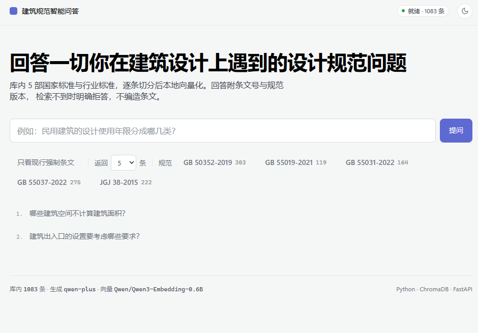
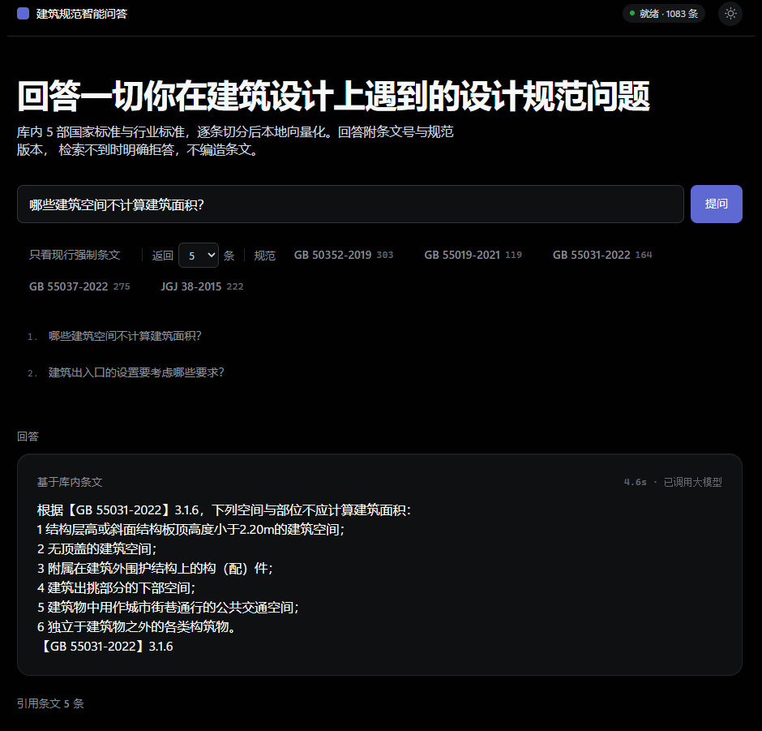

# 建筑规范 AI 助手

基于 RAG 的建筑设计规范智能问答系统。**回答必须给出「条文号 + 规范名称 + 版本号」，且严禁编造。**

提供**云端**（Dify）与**本地**（Chroma + 自研代码）两套独立可运行的实现。

| 浅色主题 · 首页 | 深色主题 · 问答结果 |
|:---:|:---:|
|  |  |

> **左**：浅色主题首页 —— 五本规范的条数由 `/api/standards` 实时读取，不在前端写死。
> **右**：深色主题下的检索问答 —— 答案逐条带条文号，附强制状态与响应耗时。

---

## 界面

本地版自带 Web 界面：**FastAPI 后端 + 单文件前端**，零 CDN、零构建、断网可开。

```powershell
cd D:\WorkBuddy\项目
& "C:\Users\A\.workbuddy\binaries\python\envs\chroma\Scripts\python.exe" -m uvicorn app.api:app --port 8000
# 浏览器打开 http://127.0.0.1:8000
```

> 启动后需等约 25 秒 —— `lifespan` 里在预热向量模型。**不要加 `--reload`**，改 `.py` 会重载模型。
> 服务默认只监听 `127.0.0.1`，**仅本机可访问**；地址请用字面量 `127.0.0.1` 而非 `localhost`。

| 能力 | 说明 |
|---|---|
| **只看现行强制条文** | 按 `force_status` 过滤，一键排除已废止条文 —— 通用 RAG 不具备的能力 |
| 按规范限定范围 | 5 本规范可任意多选组合（清单由接口现取，不在前端写死） |
| 引用卡片 | 每条列出 条文号 / 规范名 / 版本 / 强制状态标签 / 相似度 |
| **拒答态** | 库内无据时明确回「未收录」，不编造 |
| 明暗主题 | 两套配色均依据 `DESIGN.md` 实现，右上角可切换 |

**接口**（前后端分离，前端只调这三个）：

| 方法 | 路径 | 说明 |
|---|---|---|
| GET | `/api/health` | 库条数、生成/嵌入模型名、LLM 是否就绪 |
| GET | `/api/standards` | 规范清单及各自条数 |
| POST | `/api/ask` | `{question, top_k, force_only, standards}` → `{answer, hits[], refused}` |

> 界面外观遵循仓库根目录的 `DESIGN.md`（取自 `VoltAgent/awesome-design-md`，MIT）。

---

## 为什么需要它

通用大模型回答建筑规范问题时，有三个不可接受的缺陷：

| 缺陷 | 后果 |
|---|---|
| 不给条文号 | 答案是"死无对证"的，无法核对 |
| 引用已废止版本 | 例如 GB 50016-2014 的强制性条文已被 GB 55037-2022 废止，照旧引用等于违规 |
| 编造条文 | 危害大于"不知道"——使用者会当成真依据 |

本项目用工程手段解决这三条：**条文级切分 + 强制引用 + 元数据过滤 + 双层拒答**。

## 核心设计决策

| 决策点 | 选择 | 理由 |
|---|---|---|
| 知识组织 | **RAG 优先**（非 Wiki） | 规范数量增长时，RAG 边际成本 ≈ 0；Wiki 人工整理成本随规范数线性增长 |
| 编排形态 | **Chatflow**（非 Agent） | 无需外部工具调用；Agent 的自主性对"必须引用、不得编造"是风险而非优势 |
| 切分粒度 | **一条正文 = 一个 chunk** | 保证检索到的内容完整、可整条引用，绝不从中间截断 |
| 版本管理 | 每条携带 `force_status` | 强制 / 参考 / 已废止 —— 这是本项目的核心行业价值 |
| 拒答策略 | **Prompt 层**（不靠 Score 阈值） | 实测负例最高分 0.727 > 正例 5% 分位 0.675，**阈值窗口不存在** |

## 技术栈

### 数据层（OCR 与切分）

| 组件 | 版本 | 用途 |
|---|---|---|
| Python | 3.13 | 全链路运行时 |
| PyMuPDF | latest | 探测文本层、按坐标渲染页面、抽取嵌入表格 |
| PaddleOCR | 3.7.0（源码安装） | 扫描件中文 OCR |
| PP-OCRv6_medium | — | 检测 + 识别模型（CPU 推理） |

### 检索层（本地版）

| 组件 | 版本 | 用途 |
|---|---|---|
| ChromaDB | 1.5.9 | 向量库（PersistentClient + HNSW/cosine） |
| sentence-transformers | 6.0.1 | 向量化框架 |
| Qwen/Qwen3-Embedding-0.6B | 1024 维 | 嵌入模型（查询侧需 `prompt_name="query"`） |
| torch | 2.14.0 (CPU) | 推理后端 |
| transformers | 5.17.0 | 模型加载 |
| numpy | 2.5.3 | 向量缓存（`.npy`） |

### 生成层

| 组件 | 说明 |
|---|---|
| 通义千问 `qwen-plus` | 阿里云百炼 · **OpenAI 兼容接口**（`/compatible-mode/v1`） |
| requests 2.34.2 | 直接发 HTTP，**不引入 openai SDK**（少一个依赖，接口可随时换 DeepSeek/Ollama） |
| python-dotenv 1.2.3 | 从 `.env` 读 Key，不入库 |

### 云端版

| 组件 | 说明 |
|---|---|
| Dify Cloud（Sandbox） | Chatflow 编排 + 内置知识库 + 自带 WebApp UI |
| `text-embedding-v4` | 1024 维（与本地 0.6B **同维**，但两者向量空间不同、不可混用） |
| Rerank | ⚠️ 必开 —— TopK 与 Score 阈值**仅在启用 Rerank 后生效** |

### 评测与工程

| 组件 | 说明 |
|---|---|
| 自研评测集 | **86 条**（77 正例 + 9 拒答负例），金标为条文号 |
| 自研跑分器 | `run_eval.py`，Recall@1/3/5/10、MRR、名次分布、阈值窗口扫描 |
| RAGAS 0.4.3 | 语义层判官：`context_recall` / `context_precision`（本地/云端各一跑） |
| Git / GitHub | 仓库只收录自研代码与文档 |

> 项目**未使用** pytest 等测试框架 —— 验证依靠各模块内置自检 + 独立校验脚本，清单见 `AGENT.md`。

## 两套实现

| 维度 | 云端版（Dify） | 本地版（Chroma） |
|---|---|---|
| 入口 | WebApp URL / iframe 嵌入 | `python -m app.cli` |
| 向量库 | Dify 内置知识库 | 本机 Chroma（`D:\WorkBuddy\chroma_db`） |
| 嵌入模型 | `text-embedding-v4` (1024d) | Qwen3-Embedding-0.6B (1024d) |
| 检索增强 | 高质量索引 + Rerank | 纯向量 + **元数据过滤** |
| 生成模型 | 通义千问（Dify 内配置） | 通义千问（`.env` 配 Key） |
| 界面 | ✅ 开箱即用（WebApp） | ✅ 自建 Web 界面 + 命令行（见上方「界面」一节） |
| 离线可用 | ❌ | ⚠️ 检索可全离线，生成需 API |
| 主要限制 | 元数据**只支持文档级**；Sandbox 限流 10 次/分钟 | 需自备模型与 Key |
| 最优场景 | 演示、分享、快速验证 | 自控、可过滤、可深度定制 |

**评测成绩（本地，86 条）**：Recall@1/5 = **87.0 / 100 %**，MRR **0.926**，未命中 **0/77**；RAGAS 语义层 `context_recall` **0.987** / `context_precision` **0.907**。详见下方「检索评测」。

## 检索评测

评测分两层，**互补而非替代**：

| 层 | 工具 | 判据 | 成本 | 回答什么问题 |
|---|---|---|---|---|
| 条文号级 | 自研 `run_eval.py` | 金标条文号是否召回、排第几 | **0**（不调 LLM，秒出） | 具体漏了哪一条 |
| 语义级 | **RAGAS** `context_recall` / `context_precision` | LLM 判官逐条判定相关性 | 少量 API 费 | 整体语义质量与趋势 |

RAGAS **只给分数、不给原因**，`run_eval.py` 精确但不懂语义 → 两者都留，**先用 RAGAS 看趋势，再用条文号排名定位**。

### 评测集

**86 条 = 77 正例 + 9 拒答负例**，金标为条文号，按 `type`（numeric/semantic/keyword/table）、
`difficulty`、`standard` 三个维度切片。正例的标准答案（`reference`）由金标条文号回查语料原文**全自动生成**，零人工标注。

### 本地版成绩（Chroma + Qwen3-Embedding-0.6B，TopK=10）

| 指标 | 值 | 说明 |
|---|---|---|
| Recall@1 | **87.0%** | 67/77 |
| Recall@3 | **97.4%** | |
| Recall@5 / @10 | **100%** | 77/77 |
| MRR | **0.926** | |
| 未命中 | **0 / 77** | |
| 负例超阈 | **9 / 9** | 见下方「阈值窗口」 |

**名次分布**：第 1 位 67 / 第 2 位 7 / 第 3 位 1 / 第 4 位 2。

### RAGAS 语义层成绩（判官 `qwen-plus`，`temperature=0`）

| 指标 | 值 | 参考线 |
|---|---|---|
| `context_recall` | **0.987** | > 0.85 |
| `context_precision` | **0.907** | > 0.5 |
| 判官解析失败（NaN） | **0** | 0 |

切片：按题型仅 `semantic` 0.944（其余 1.000）；按规范仅 `GB 50352-2019` 0.917（其余 1.000）；按难度 hard 0.972 / medium 0.988 / easy 1.000。

### 阈值窗口不存在 —— 拒答只能靠 Prompt

| 量 | 值 |
|---|---|
| 负例最高分 | **0.727** |
| 正例金标分数 5% 分位 | **0.701** |

正例分数没有明显高于负例 → **任何阈值都会同时误伤**，9/9 负例超阈。
所以本项目把拒答做在 **Prompt 层**（7 条铁律 + 库内无据即明确回「未收录」），而不是靠 Score 阈值。

### 低分归因：先查名次，再决定改不改代码

RAGAS 的 `context_precision` 是 **MAP**（分母为判官认定的全部相关条数）——判官多认一条排在第 4~5 位的同主题条款，P 就从 1.0 掉到 0.5，**而检索完全没错**。因此低分行不能直接当成缺陷。

把导出的 `contexts` 精确匹配回语料（**385/385 = 100% 可回溯**）后求得金标真实名次，18 条低分（P<0.9）拆解如下：

| 类别 | 题数 | 处理 |
|---|---|---|
| 指标数学性质（金标就在第 1 位） | **12** | 不动 |
| 跨规范抢位（Top1 来自另一本规范） | 4 | 语料特性，见下 |
| 同规范内被同主题簇挤到第 3~4 位 | 2 | 需 rerank |

此外 **无一条「完全未召回」**。真正值得记一笔的只有 1 题：`GB52-02`（地下室/半地下室定义）的多条金标只召回一条 —— 两条定义条款措辞仅差 1/2 与 1/3，属术语近邻混淆，检索层无低成本修法。

> 另需注意：有 2 题出现 **`context_recall` 与 `context_precision` 自相矛盾**（如 R=1.00 而 P=0.00）——两个指标的判官 prompt 不完全一致，**P=0 不可解读为「检索全错」**，以金标名次为准。

**跨规范抢位不是缺陷**：`GB 55031-2022 民用建筑通用规范`（164 条）本就是 `GB 50352-2019`（303 条）的强条提炼版，两本语义近重复、互相抢位（实测 5/77 = 6.5%）。本产品定位是**跨规范答疑**，返回提炼版强条往往比原标准更合适，因此**不按 `standard` 过滤**。

### 评测过程中修掉的问题（均在评测侧，检索层未动）

| 问题 | 后果 | 状态 |
|---|---|---|
| **金标匹配器只比条文号、不比规范号** | 多规范语料条文号必然撞号 → Recall@1 虚高 | 已修：匹配时增加规范号比对 |
| 4 条金标指向「节标题」空壳 chunk | 检索到只有 4 个字的标题即算命中，虚报召回 | 已修：只留条文号/表号 |
| 1 条 `query` 用词与金标错配 | 泛词诱导了字面匹配 | 已修：改为与金标一致的措辞 |
| 生成脚本缺校验 | 同类缺陷会再次混入 | 已加：金标不得指向空壳 chunk，违反即 exit 1 |
| 1 条 `gold` 值存在但与问题无关 | 值通过存在性校验、语义全错 | **已定位，待修**：存在性校验拦不住这类错标，需人工读 gold 正文核验相关性 |

> 修完这些后 Recall@1 由 88.3% 修正为 **87.0%**（MRR 0.933 → 0.926）—— 分数是**变低**的，因为修掉的正是虚高部分。

### 复现

```powershell
$PY_CHROMA = "C:\Users\A\.workbuddy\binaries\python\envs\chroma\Scripts\python.exe"
$PY_RAGAS  = "C:\Users\A\.workbuddy\binaries\python\envs\ragas\Scripts\python.exe"
cd "D:\WorkBuddy\项目\输出文档\检索评测"

& $PY_CHROMA build_evalset.py                                       # 生成 + 校验评测集
& $PY_CHROMA run_eval.py --backend chroma --profile local           # 条文号级（0 成本）
& $PY_CHROMA ragas_eval.py --stage export --top-k 5                 # 导出检索结果（0 成本）
& $PY_RAGAS  ragas_eval.py --stage doctor --no-call                 # 零成本验链路
& $PY_RAGAS  ragas_eval.py --stage score --concurrency 3            # LLM 判官层
```

> 云端版可用 `--backend dify --profile pure` 跑同一份评测集，与本地做 A/B（唯一变量为嵌入模型）。

## 数据源

全部来自**住房和城乡建设部**（`mohurd.gov.cn`）公开发布的规范文本。

> 注意：`openstd.samr.gov.cn`（国家标准全文公开系统）**不收录工程建设标准**，规范必须从住建部官网的公告附件获取。

| 规范编号 | 名称 | 页数 | 强制情况 |
|---|---|---|---|
| GB 50352-2019 | 民用建筑设计统一标准 | 68 | 4 条强条已由 GB 55031-2022 废止 |
| GB 55019-2021 | 建筑与市政工程无障碍通用规范 | 20 | 全文强制 |
| GB 55031-2022 | 民用建筑通用规范 | 24 | 全文强制 |
| GB 55037-2022 | 建筑防火通用规范 | 66 | 全文强制 |
| JGJ 38-2015 | 图书馆建筑设计规范 | 69 | 行业标准 |

方向锚定**公共建筑 / 图书馆**——与本人的图书馆课程设计同步，做到"自用即验证"。

**切分产物**：1083 chunk / 94,124 字（正文 949、章节 111、表格 22、附录表 1）。

## 处理流水线

```
住建部 PDF（无文字层扫描件）
        │
        ▼  ① OCR —— PaddleOCR PP-OCRv6（CPU）
   分页 markdown（带 <!-- page N --> 标记）
        │
        ▼  ② 确定性修复 —— build_v4.py（白名单 INS/DEL/REPL/MOV）
        ▼  ③ 条文边界切分 —— split_articles_v2.py
   chunks_v5（一条 = 一个完整 chunk，头部含元数据）
        │
        ├──▶ ④ 校验 —— validate_chunks.py（9 项指标归零）
        │
        ├──▶ ⑤-A 云端：5 个 md → Dify 知识库 → Chatflow
        └──▶ ⑤-B 本地：向量化 → Chroma → app/ 代码链路
```

### 关键技术细节

**OCR 渲染分辨率不固定**：住建部扫描件结构不一（有整页单图、也有 2×4 分块拼接），必须按**每张嵌入图像自身的放置矩形**推算原生像素密度，否则会凭空丢失一半信息。本批 PDF 还带**水印假文字层**，判据须用字符数阈值（≥200）而非"有无文本层"。

**切分依据是条文号，不是字数**：以行首三级编号（如 `3.1.6`）为边界。跨页条文**不 flush**，自动接续，保证完整性。

**页脚与表格数值必须分开处理**：一条"整行是 1~3 位纯数字就丢弃"的清理规则会连表格数值一起吃掉（实测 399 行）。修法是改用**位置判据**——只有位于页面**最后一个非空行**的裸数字才当页码丢弃。

**筛选掉非正文**：目次、附录、条文说明必须在正文首条（`1.0.1`）之前被拦截，否则条文说明会被整本收进知识库。

**元数据须由系统注入，不能指望模型生成**：每条检索片段在送进 LLM 前会被包上 `【规范名 + 版本 + 条文号 + 强制状态】` 头部，否则模型要么编条文号，要么干脆不标。

## 目录结构

```
项目/
├── app/                        # 本地版应用（按层拆分，可单独自检）
│   ├── __init__.py             #   最先设 HF_HOME —— 顺序保障，不可挪
│   ├── config.py               #   唯一配置入口 + 路径 ASCII 断言
│   ├── retriever.py            #   检索层（不碰大模型）
│   ├── prompts.py              #   7 条铁律（与 Dify 文档逐字 diff 自检）
│   ├── llm.py                  #   生成层（通义千问 · OpenAI 兼容）
│   ├── pipeline.py             #   编排层（0 命中即短路拒答）
│   ├── cli.py                  #   命令行入口 + 元数据过滤预设
│   └── api.py                  #   Web 接口层（FastAPI，复用 pipeline）
├── web/
│   └── index.html              #   单页前端（零 CDN，由 FastAPI 顺带托管）
├── 建筑规范PDF/                 # 规范原件（PDF 受版权保护，不入库）
├── 输出文档/                    # 流水线产物与文档（仅 *.md 与 scripts/ 入库）
│   ├── scripts/                #   OCR / 修复 / 切分 / 校验 / 建库 / 自检脚本
│   ├── chunks_v5/              #   ★ 现行切分产物（chunks_v4 保留作回退）
│   ├── 检索评测/                #   86 条评测集 + 跑分器（条文号级 + RAGAS 语义级）
│   ├── docs/                   #   技术方案笔记
│   └── *.md                    #   各阶段说明文档
├── requirements.txt
├── .env.example
├── .gitignore
├── DESIGN.md                   # 前端设计规范（Linear 风格 token）
├── AGENT.md                    # 协作与提交规范
└── README.md
```

## 本地版快速开始

```powershell
# 0) 指定解释器（本机 venv 实测环境）
$PY = "C:\Users\A\.workbuddy\binaries\python\envs\chroma\Scripts\python.exe"

# 1) 装依赖
& $PY -m pip install -r requirements.txt

# 2) 配 Key（Key 只放 .env，绝不入库）
Copy-Item .env.example .env
#    编辑 .env，填 DASHSCOPE_API_KEY=sk-xxxx

# 3) 建库（两段式：先向量化，再入库；库目录必须纯 ASCII）
cd "D:\WorkBuddy\项目"
& $PY "输出文档\scripts\build_index.py" --stage vec
& $PY "输出文档\scripts\build_index.py" --stage db

# 4) 自检
& $PY "输出文档\scripts\verify_index.py"      # 7 项，不加载模型

# 5) 提问
& $PY -m app.cli "图书馆阅览室到最近疏散门的最大距离是多少"
& $PY -m app.cli --no-llm "半地下室的定义"      # 只检索、不花钱
& $PY -m app.cli --preset force-only "防火分区的最大面积"
```

> 运行 `-m app.xxx` 必须 `cd` 到项目根（`-m` 按包导入）。

## 云端版快速开始

1. 用 `输出文档\chunks_v5\dify\` 下 **5 个** md 建知识库，索引选**高质量**，分段模式按 `@@@` 分隔符、最大长度 ≥2000
2. 每本规范在**文档级**挂 5 个元数据字段：`standard / standard_name / version / force_status / status`
3. 建 Chatflow，System 提示词照抄 `输出文档\Dify导入说明.md` 第三节的 **7 条铁律**（逐字，勿润色）
4. Temperature 设 **0~0.2**，开启**引用块**与 **Rerank**
5. 验收唯一判据：**问"9.9.9 条"等不存在内容必须拒答**

## 合规说明

本仓库**不包含**规范原文、扫描件 PDF 及 OCR 产物：

- 规范文本的**版权**归住房和城乡建设部 / 中国建筑工业出版社。工程建设类国标虽在住建部官网可免费阅读，但公开声明「仅供个人学习研究，未经授权禁止复制、发行、汇编、翻译或网络传播」——课程、毕设、自用无风险，**一旦对外发布或商用则不可做全文再分发**。
- 原始 PDF 体积达 88 MB，不适合纳入版本控制
- 全部中间产物均可由脚本重新生成

> 产品化时的替代做法：只返回**条文号 + 摘录**并注明出处，而非提供规范全文。

**仓库只包含自研处理代码与文档。**

## 进度

- [x] 规范收集（5 本，住建部官方源）
- [x] 扫描件 OCR 流水线（PP-OCRv6）
- [x] 条文级切分（1083 chunk，9 项校验指标归零）
- [x] 云端版：Dify 知识库 + Chatflow（已上线，带条文号引用 + 拒答验收通过）
- [x] 评测集构建（86 条 = 77 正例 + 9 拒答负例）
- [x] 本地版：Chroma 向量库 + 代码链路（`app/` 7 模块，命令行可问答）
- [x] 本地评测跑分（Recall@1 = 87.0%，MRR = 0.926，未命中 0/77）
- [x] 语义层评测接入 RAGAS（`context_recall` 0.987 / `context_precision` 0.907）
- [x] 评测集缺陷修复（金标匹配加规范号、4 条空壳金标、2 条措辞/错标）+ 新增校验防复发
- [x] 自建 Web 界面（FastAPI 接口 + 单页前端，支持强制条文过滤）

## 环境

| 项 | 值 |
|---|---|
| 操作系统 | Windows 11 |
| Python | 3.13（venv `envs\chroma`） |
| 推理设备 | CPU |
| 向量库路径 | `D:\WorkBuddy\chroma_db`（**必须纯 ASCII**） |
| 模型缓存 | `D:\WorkBuddy\models\hf`（`HF_HOME`） |

---

*个人学期项目 · 2026*
